[Back to the dashboard](index.html)

**Additional model outputs accompanying the manuscript; these are outside the submitted Supporting Information.** Every figure on this page is the file written by the analysis code, unaltered, and every table is offered as the file the analysis wrote. The [manifest](supplementary/manifest.csv) lists each published file, the analysis output it was copied from and its MD5 checksum. The [download dictionary](supplementary/download-dictionary.csv) defines the columns of each table.

Throughout, DLBCL, FL and MCL are subtypes of aggregate non-Hodgkin lymphoma (NHL) and do not sum to it; total lymphoma is Hodgkin lymphoma (HL) plus aggregate NHL. Credible intervals (CrI) are the 2.5th and 97.5th percentiles of 1,000 Monte Carlo draws. They propagate parameter uncertainty conditional on the fitted models and the specified survival distributions, and are not adjusted for extra-Poisson variation or for model selection. AIHW is the Australian Institute of Health and Welfare; ABS is the Australian Bureau of Statistics.

# Incidence model

## Additional figure A1. Estimated age effects, by lymphoma and sex

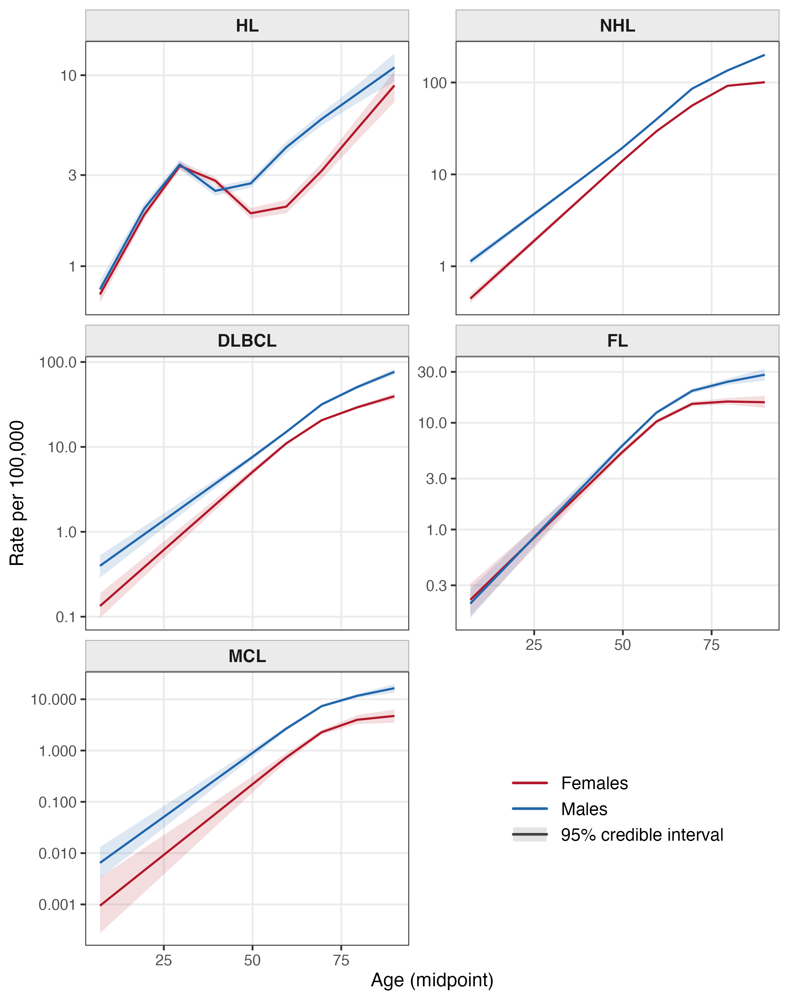{fig-alt="Fitted age-specific incidence rates on a logarithmic scale, one panel per lymphoma, females and males."}

Each panel shows one lymphoma, with females and males plotted separately. The vertical scale differs between panels, so panel heights are not comparable. Lines are point estimates; ribbons are 95% credible intervals. Age effects are the fitted age-specific incidence rates at each model's reference birth cohort (the case-weighted median cohort of that lymphoma-and-sex series, so the reference differs between the sexes), with the period effect at its reference. They are model components, not observed rates for a single calendar year, so the comparison between the sexes is of shape and level under each model's own reference. Rates are drawn on a logarithmic scale because age-specific incidence spans more than an order of magnitude.

## Additional figure A2. Estimated period effects, by lymphoma and sex

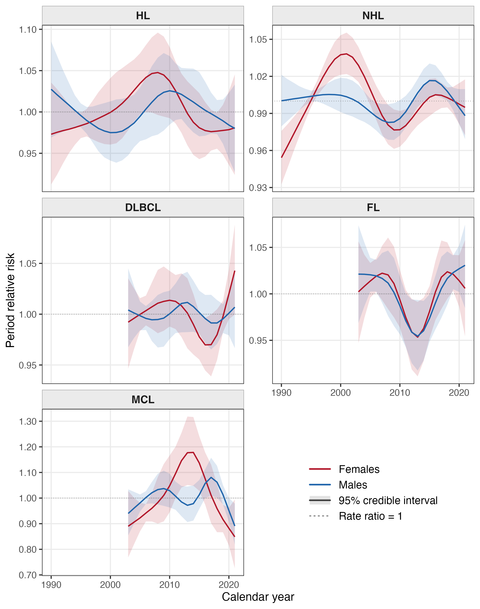{fig-alt="Period relative risks by calendar year, one panel per lymphoma, females and males."}

Relative risks are normalised to each lymphoma-and-sex model's case-weighted reference period; comparisons between sexes therefore concern modelled patterns under their respective references. The vertical scale differs between panels. Lines are point estimates; ribbons are 95% credible intervals. The horizontal line marks a relative risk of 1.0.

## Additional figure A3. Estimated cohort effects, by lymphoma and sex

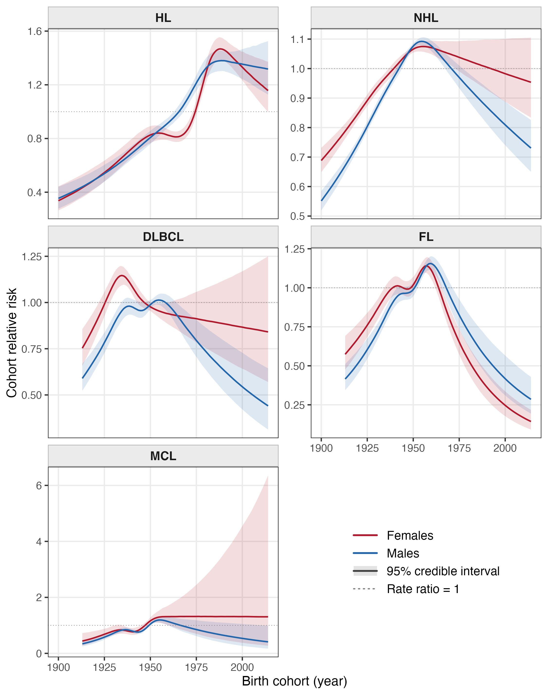{fig-alt="Cohort relative risks by year of birth, one panel per lymphoma, females and males."}

Relative risks are normalised to each lymphoma-and-sex model's case-weighted reference cohort; comparisons between sexes therefore concern modelled patterns under their respective references. The vertical scale differs between panels. Lines are point estimates; ribbons are 95% credible intervals.

## Additional figure A4. Incidence holdout

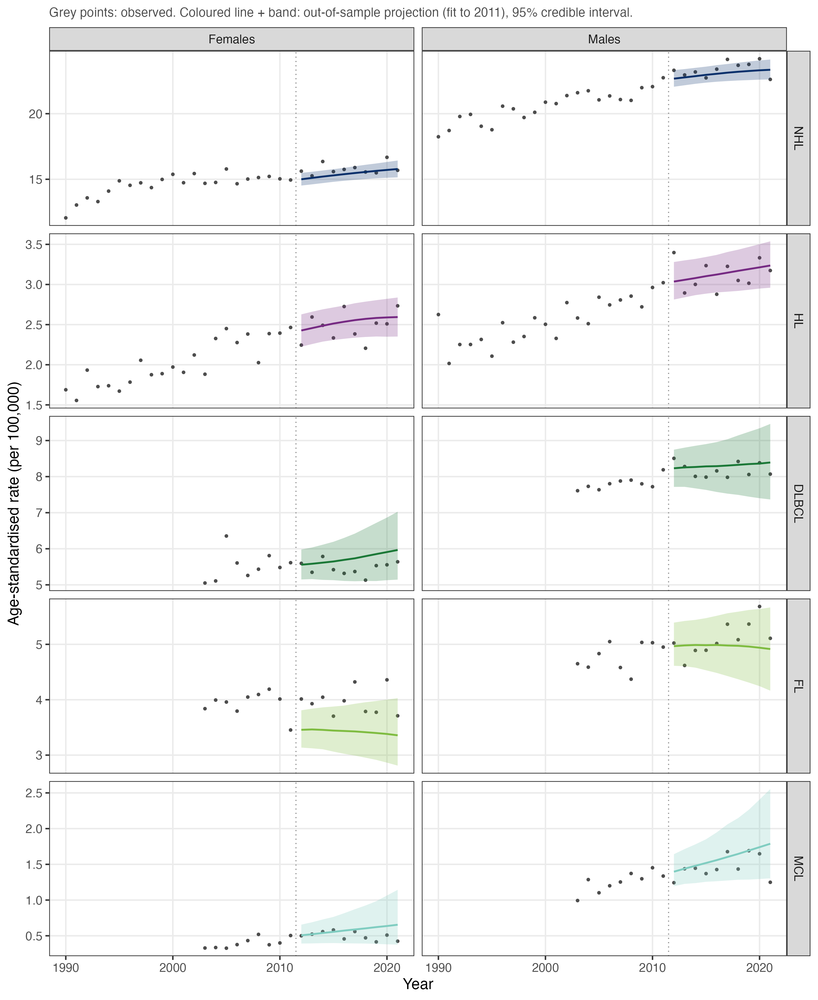{fig-alt="Observed age-standardised incidence with out-of-sample projections for 2012 to 2021 from models fitted to 2011, by lymphoma and sex."}

Each model was refitted to data ending in 2011 (1990 to 2011 for HL and aggregate NHL; 2003 to 2011, nine years, for the NHL subtypes) and used to project 2012 to 2021, the years to the right of the dotted line. Grey points are observed age-standardised incidence; the coloured line and band are the projection and its 95% credible interval. The same 2012 to 2021 window informed the choice of the aggregate start year and the number of spline knots, so this is temporal backtesting used for model selection, not an independent evaluation of the selected model. The intervals are credible intervals for the expected rate, not prediction intervals for the realised rate, so their coverage of the observed points is not expected to reach 95%.

# Survival

## Additional figure A5. Survival curves used in the prevalence computation

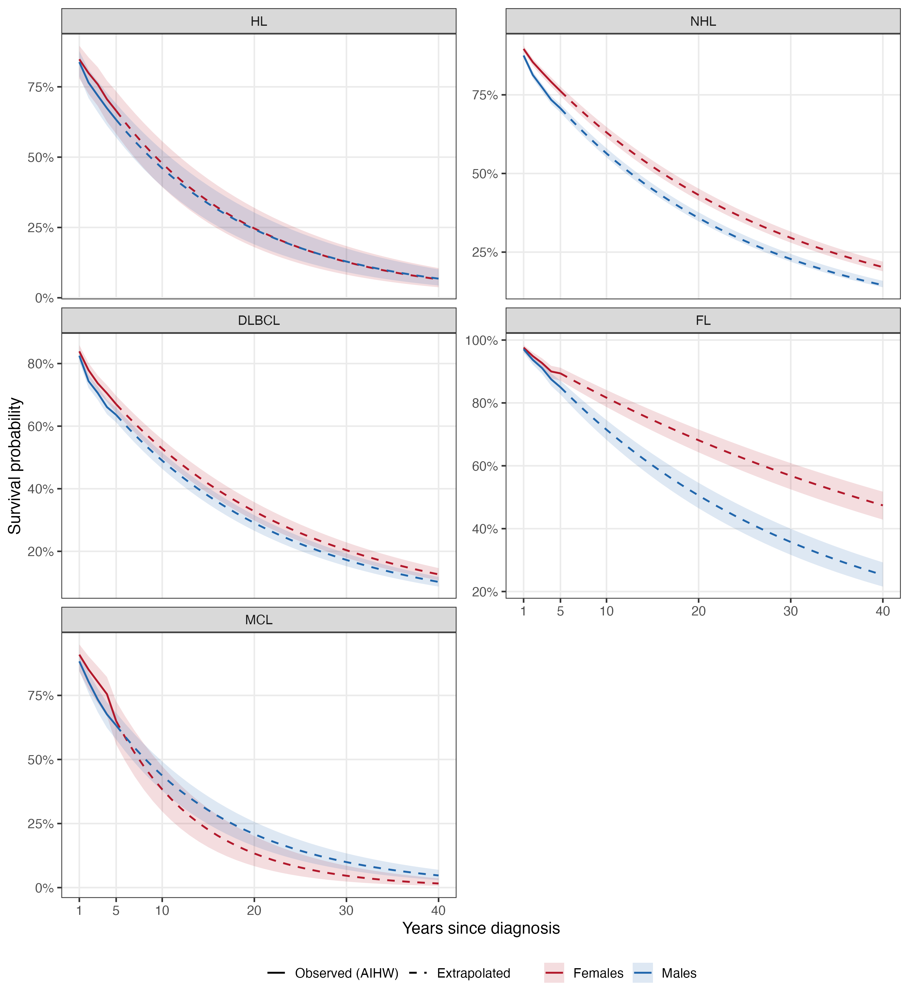{fig-alt="Cumulative survival to 40 years after diagnosis for people aged 65 to 74 diagnosed in 2019, by lymphoma and sex."}

Age group 65 to 74, diagnosed 2019. Solid lines: AIHW observed (all-cause) survival, years 1 to 5. Dashed lines: extrapolation to 40 years holding the years 3-to-5 conditional survival constant. Ribbons: 95% confidence intervals from the AIHW. These are deterministic point curves. Because survival improvement is applied additively and extrapolated to diagnosis years before the earliest observed period, a point curve can rise between consecutive years within the observed window; where it does, the implied conditional survival used for the extrapolation is capped at one.

## Additional figure A6. Worked example of one modelled survival curve

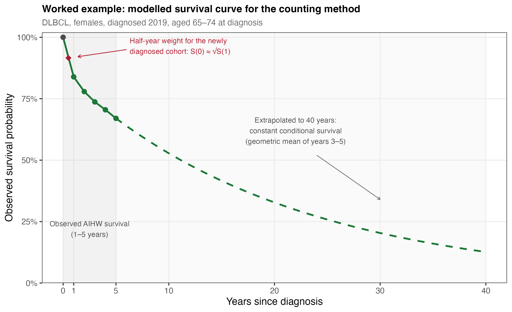{fig-alt="One survival curve annotated with the half-year weight, observed years 1 to 5 and the extrapolated tail."}

DLBCL, females, aged 65 to 74 at diagnosis, diagnosed 2019. Green points and solid line: AIHW observed survival, years 1 to 5. Red diamond: the half-year survival weight, the square root of first-year survival, applied to the year-of-diagnosis cohort in the counting method. Dashed line: extrapolation to 40 years using a constant conditional survival (the geometric mean of the years 3-to-5 conditional survival). The constant tail does not increase mortality with attained age, so it over-counts very-long-term survivors in older-onset disease. The caveat on deterministic point curves given under figure A5 applies here too.

## Additional figure A11. Modelled case-weighted 5-year survival by year of diagnosis

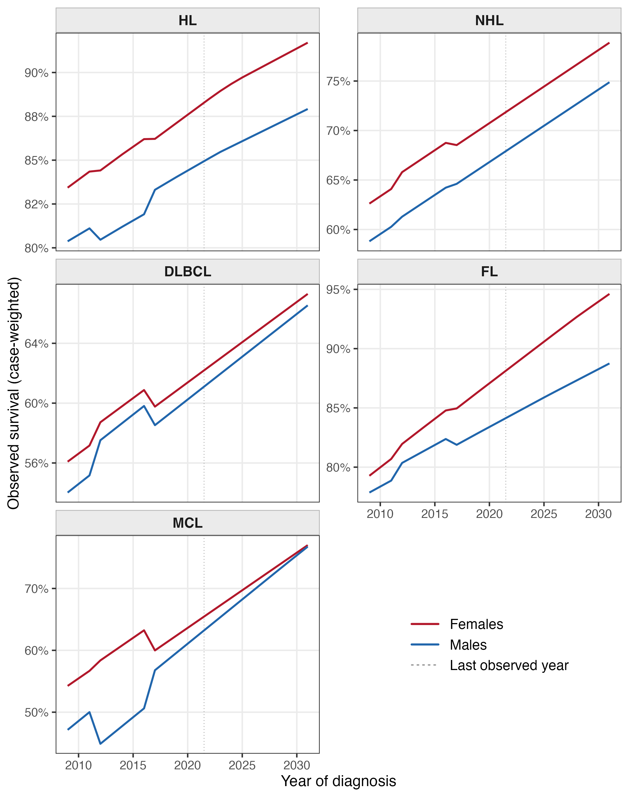{fig-alt="Modelled five-year survival by year of diagnosis, one panel per lymphoma, females and males."}

This is modelled survival, not an independent observation: it is informed by AIHW observed survival for the periods 2007 to 2011, 2012 to 2016 and 2017 to 2021, weighted across age groups by diagnoses, and extrapolated by the fitted annual improvement. The dotted vertical line marks 2021, the last observed year of diagnosis; improvement is extrapolated beyond it to the 2031 cap year in the base case. The figure shows the survival input to the prevalence projection. It does not validate that input and does not decompose the growth in prevalence. The vertical scale differs between panels.

## Additional figure A12. Modelled case-weighted 10-year survival by year of diagnosis

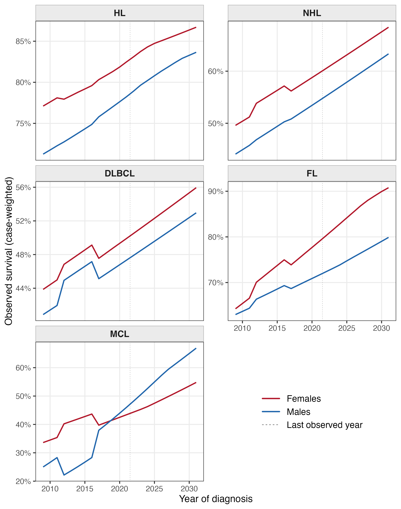{fig-alt="Modelled ten-year survival by year of diagnosis, one panel per lymphoma, females and males."}

As figure A11, at 10 years. The AIHW observes survival to five years only, so every value in this figure also rests on the extrapolation beyond the five-year observation window, which holds the years 3-to-5 conditional survival constant. It is modelled survival throughout.

# Population

## Additional figure A7. Australian population age structure, 2021 and 2045

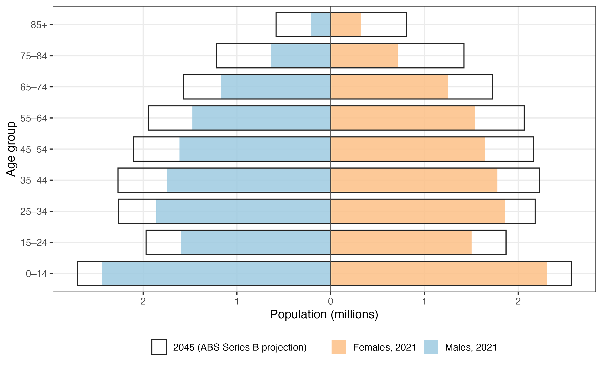{fig-alt="Population pyramid comparing 2021 with the projected 2045 population."}

Filled bars show the estimated resident population at 2021; outlines show the ABS Series B (medium-growth) projection for 2045. Males are drawn to the left of the axis and females to the right.

# Prevalence at additional durations

The main article reports prevalence at 5, 10 and 40 years, the durations at which the AIHW also publishes prevalence. The 2- and 3-year estimates have no published comparator. Every value, for every year, is available through the [dashboard](index.html) and its data download; the 2021 and 2045 values with the change between them are in additional table A7.

## Additional figure A8. Projected 2-year prevalence, by lymphoma and sex

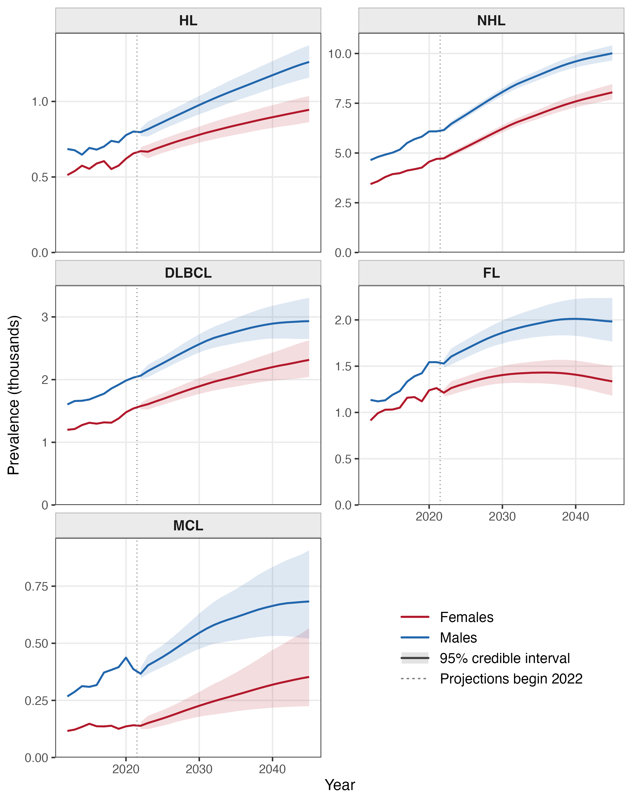{fig-alt="Two-year prevalence to 2045, one panel per lymphoma, females and males."}

## Additional figure A9. Projected 3-year prevalence, by lymphoma and sex

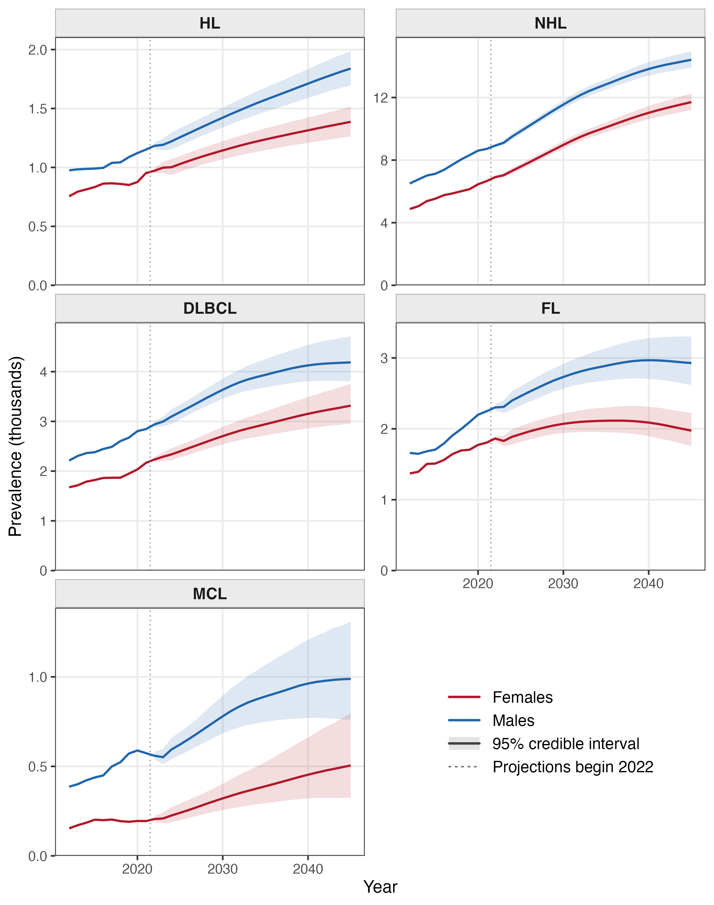{fig-alt="Three-year prevalence to 2045, one panel per lymphoma, females and males."}

## Additional figure A10. Projected 10-year prevalence, by lymphoma and sex

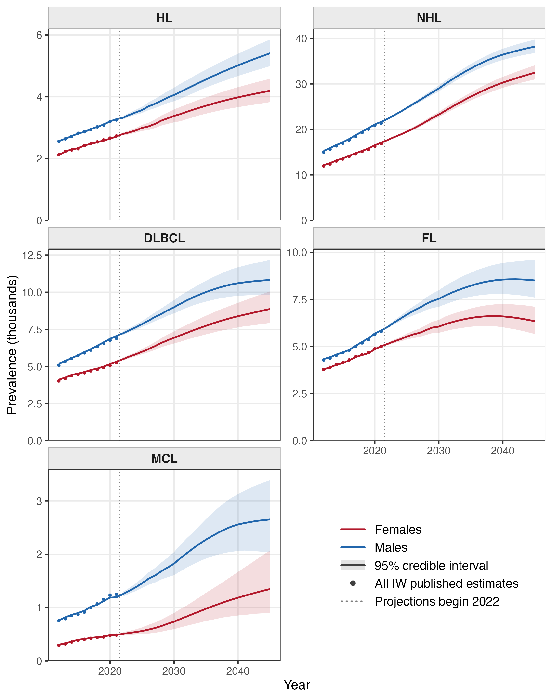{fig-alt="Ten-year prevalence to 2045 with AIHW published estimates for 2012 to 2021, one panel per lymphoma, females and males."}

For figures A8 to A10: each panel shows one lymphoma, with females and males plotted separately, and the vertical scale differs between panels. Lines are medians across Monte Carlo draws; ribbons are 95% credible intervals. In figure A10 the points are AIHW published prevalence estimates for 2012 to 2021 (Cancer Data in Australia Book 6 for HL and aggregate NHL; Blood Cancer Framework Table S11i.1 for the subtypes), shown for comparison.

# Sensitivity to continued survival improvement

Three scenarios differ only in the year of diagnosis after which survival improvement is held constant: conservative (2021, no further improvement), base case (2031) and optimistic (2036). All three use the same incidence projections.

## Additional figure A13. Sensitivity of 5-year prevalence to the cap year

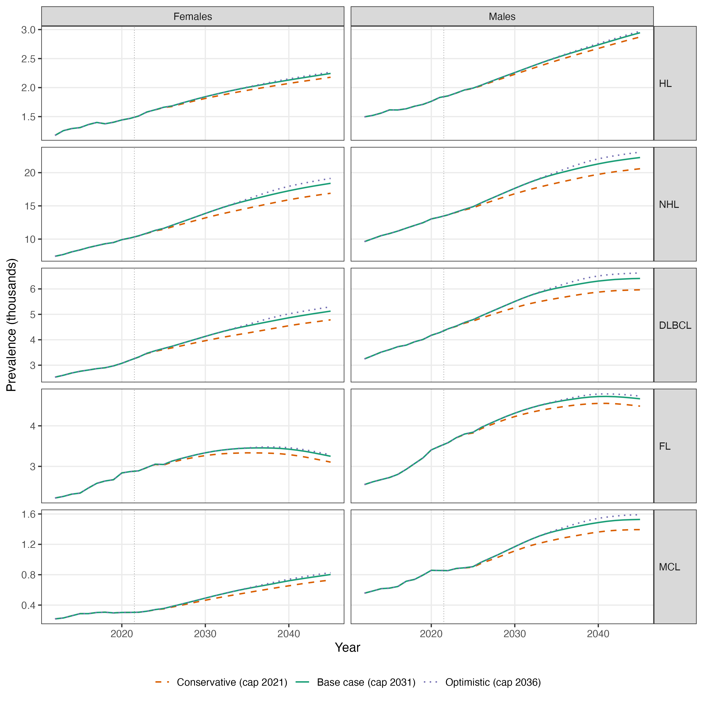{fig-alt="Five-year prevalence under three survival improvement scenarios, by lymphoma and sex."}

## Additional figure A14. Sensitivity of 40-year prevalence to the cap year

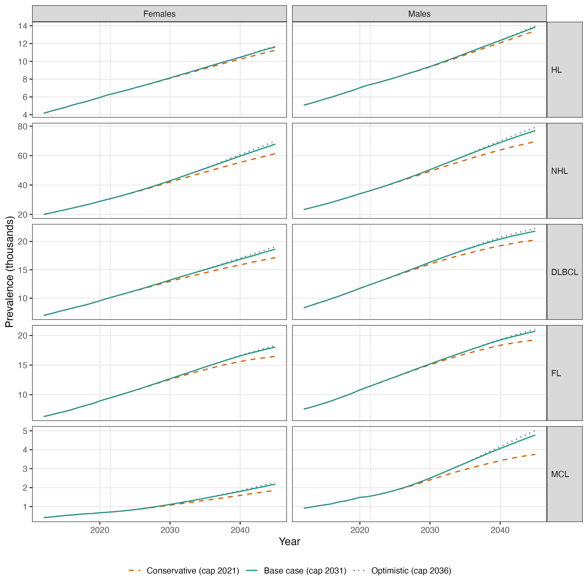{fig-alt="Forty-year prevalence under three survival improvement scenarios, by lymphoma and sex."}

For figures A13 and A14: solid lines show the base case, dashed lines the conservative scenario and dotted lines the optimistic scenario.

# Tables to download

| Label | Content | File |
|---|---|---|
| Additional table A1 | Fit statistics for the ten age-period-cohort models | [table_s2_apc_fit_stats.csv](supplementary/tables/table_s2_apc_fit_stats.csv) |
| Additional table A2 | Back-estimated 2000 against observed 2003 subtype incidence. A consistency check near the boundary; it does not establish that the subtype mix was stable back to 1982 | [table_s3_back_estimation.csv](supplementary/tables/table_s3_back_estimation.csv) |
| Additional table A3 | Aggregate incidence projections against AIHW projections, 2026 to 2035. A comparison with prior forecasts, not a validation | [table_s4_incidence_aihw.csv](supplementary/tables/table_s4_incidence_aihw.csv) |
| Additional table A4 | Modelled NHL subtypes as a share of aggregate NHL incidence | [table_s5_consistency.csv](supplementary/tables/table_s5_consistency.csv) |
| Additional table A5 | Annual survival improvement rates: summary, and every age group with the source of each rate | [table_s7_improvement_rates.csv](supplementary/tables/table_s7_improvement_rates.csv), [table_s7_improvement_rates_full.csv](supplementary/tables/table_s7_improvement_rates_full.csv) |
| Additional table A6 | 40-year prevalence at 2021 against AIHW published values, by sex. The subtype rows are a coverage figure, not a comparison with a published value | [table_s9_40yr_prevalence.csv](supplementary/tables/table_s9_40yr_prevalence.csv) |
| Additional table A7 | 2021 and 2045 values with the change and its 95% credible interval: incidence by sex; prevalence at all five durations by sex; prevalence at all five durations, persons. Three files with different layouts | [table_1_change_cri.csv](supplementary/tables/table_1_change_cri.csv), [table_2_change_cri.csv](supplementary/tables/table_2_change_cri.csv), [table_3_prevalence_combined.csv](supplementary/tables/table_3_prevalence_combined.csv) |
| Additional table A8 | Survival improvement scenarios: total lymphoma at key years, and every lymphoma, sex, duration and year | [table_s12_sensitivity.csv](supplementary/tables/table_s12_sensitivity.csv), [prevalence_sensitivity.csv](supplementary/tables/prevalence_sensitivity.csv) |
| Additional table A9 | Model-specification sensitivity: knot selection grid, start year, damping rate, exclusion of 2020 to 2021 | [table_s_knot_selection.csv](supplementary/tables/table_s_knot_selection.csv), [table_s_start_year_sensitivity.csv](supplementary/tables/table_s_start_year_sensitivity.csv), [table_s_damping_sensitivity.csv](supplementary/tables/table_s_damping_sensitivity.csv), [table_s_covid_sensitivity.csv](supplementary/tables/table_s_covid_sensitivity.csv) |

Changes between 2021 and 2045 are computed within Monte Carlo draws, so a reported change can differ slightly from the change implied by the rounded point estimates. Totals are formed within draws and are not sums of the medians shown. No change interval is given for incidence in persons, because none was estimated.
